# Vibe-coding Workflow

           

> One prompt. Agent writes the development context. You review the spec, then build.

A project scaffold for AI-native development. Describe your idea — the agent generates architecture files, feature specs, UI specs, and a progress tracker. You edit, not write from scratch.

Works with any coding agent that reads `AGENTS.md` and project skills: **Cursor**, **Claude Code**, **GitHub Copilot**, **Windsurf**, **Antigravity**, and similar.

This repo is built for **Case 1** (from nothing). Cases 2 and 3 reuse the same rules for skills, CLI, MCP, and hooks — they need extra process skills, not a different editor.

---

## Which case are you in?

| Case | Starting point | This repo |
|---|---|---|
| **1. Build from nothing** | An idea or a problem to solve. No app yet. | Best fit. Follow the Case 1 workflow below. |
| **2. Build from half-built source** | Code exists, incomplete or undocumented. | Keep `AGENTS.md` + `.agents/skills/`. Add onboarding and gap-fill skills. |
| **3. Scale a finished product** | App works. You need scale, ops, reliability. | Keep the same core. Add perf/devops skills and read-only ops MCP. |

---

## Quick Start

**Requires**: Node.js 18+

```bash
# 1. Use this repo as a template (recommended)
# Click "Use this template" on GitHub → create your project repo

# or clone directly
git clone https://github.com/dui14/vibe-coding-workflow.git your-project
cd your-project

# 2. (Optional) Install extra skills for your stack
npx skills add vercel-labs/agent-skills
npx skills add shadcn/ui
```

> No `npm install` needed. This repo is context files only — no runtime dependencies.

Skills install into `.agents/skills/<name>/`.

---

## Tooling by role (all cases)

Pick the layer by what it is for. Do not turn every need into an MCP server.

| Kind | Use for | Why |
|---|---|---|
| **Skill** | How to work: `bootstrap`, `code-review`, `finish-feature`, `fix-bug`; case 2/3 add `onboard-codebase`, `characterize-tests`, `triage-bug`, `gap-fill`, `perf-scale`, `devops-readiness` | Loaded only when the task matches. Free when unused. |
| **Deterministic CLI** | `gitleaks`, `semgrep`, `trivy`, `k6`, the project test runner, `ctags` | Agent runs them in the shell. Prefer CLI over MCP when a CLI already exists — MCP schemas cost tokens every turn. |
| **MCP** | Outside systems: GitHub, context7 (live docs), codegraph (code navigation), Playwright (UI). Case 3 may add **read-only** logs/metrics. | Keep **4–5 servers**. Do not grow the list. |
| **Hooks** | Proof gates (run tests/lint before the agent is allowed to stop) | Does not depend on the model remembering to verify. |

Default MCP set (case 1 and 2): **GitHub**, **context7**, **codegraph**, **Playwright**.

Put MCP config where **your** agent reads it (examples: `.mcp.json`, `.cursor/mcp.json`, `.vscode/mcp.json`). Copy the same server list; do not treat any one editor path as the source of truth.

Model routing lives in `AGENTS.md` so every agent sees the same assignment.

---

## How It Works (Case 1)

You describe the idea. Bootstrap writes context + specs. **You review that spec before any** `src/` **work.** Then you build feature by feature. `spec/progress.md` may mark a feature `done` only after its acceptance commands pass.

```mermaid
---
config:
  layout: fixed
---
flowchart LR
  subgraph AICTX["ai-context/"]
    direction TB
        A1["full: 00–08"]
        A2["lite: 3 files"]
  end
  subgraph SKILLS[".agents/skills/"]
    direction TB
        S1["bootstrap"]
        S2["code-review"]
        S3["finish-feature"]
        S4["design-taste-frontend"]
        S5["impeccable"]
  end
  subgraph MCP["MCP — 4 servers"]
    direction TB
        M1["context7"]
        M2["github"]
        M3["playwright"]
        M4["codegraph"]
  end

    IDEA["idea.md"] --> BOOT["Bootstrap"]
    BOOT --> SPEC["spec/ + ai-context/"]
    SPEC --> GATE["You review spec"]
    GATE --> AICTX
    AICTX --> BUILD["Build against spec"]
    SKILLS -.-> BUILD
    BUILD --> PROOF["AC commands pass"]
    PROOF --> PROG["progress.md = done"]
    BUILD --> MCP

    IDEA@{ shape: rounded}
    BOOT@{ shape: rounded}
    SPEC@{ shape: rounded}
    GATE@{ shape: rounded}
    AICTX@{ shape: rounded}
    BUILD@{ shape: rounded}
    PROOF@{ shape: rounded}
    PROG@{ shape: rounded}
    SKILLS@{ shape: rounded}
    MCP@{ shape: rounded}

    style IDEA fill:#7B3F00,stroke:#F2A93B,color:#ffffff
    style BOOT fill:#4B3FA5,stroke:#B7A9FF,color:#ffffff
    style GATE fill:#7B2D16,stroke:#FF9A6A,color:#ffffff
    style PROOF fill:#0D5C47,stroke:#5DE2B1,color:#ffffff
    style AICTX fill:#0F4C8A,stroke:#73B6FF,color:#ffffff,stroke-dasharray: 5 5
    style BUILD fill:#4A4A4A,stroke:#BDBDBD,color:#ffffff
    style MCP fill:#355E00,stroke:#9EEA52,color:#ffffff,stroke-dasharray: 5 5
```



```
idea.md
      ↓
Bootstrap → ai-context/ + spec/
      ↓
You review the spec (hard gate — no src/ yet)
      ↓
Bootstrap src/ structure
      ↓
Build feature → run AC commands → finish-feature
      ↓
progress.md = done only if the gate passed
```

---

## Repository Structure

```
├── AGENTS.md                     # Shared agent rules (all editors)
├── CLAUDE.md                     # Points at AGENTS.md
├── LICENSE                       # MIT License (KHANG LUONG)
├── .github
│   └── copilot-instructions.md   # Points at AGENTS.md
├── .vscode
│   └── mcp.json                  # Example MCP list (copy into your agent's config)
├── .agents/skills
│   ├── bootstrap
│   ├── code-review
│   ├── codegraph
│   ├── finish-feature
│   ├── fix-bug
│   ├── security                  # Use if the skill file has content; otherwise install a stack-matched security skill
│   ├── design-taste-frontend     # Taste Skill — landing pages and art direction
│   └── impeccable                # Review and improve UI during development
├── ai-context                    # Full mode: 00–08. Lite mode: 3 files only
├── spec
│   ├── features/                 # Runnable acceptance criteria
│   ├── ui/
│   └── progress.md
├── docs/
└── idea.md
```

See `.agents/README.md` for when to load each skill. UI UX Pro Max is not in this tree; install it before use.

---

## Case 1 — Build from nothing

### Context mode: full vs lite

| Mode | When | Files |
|---|---|---|
| **Lite** | Small project (landing page, script, single-purpose tool). Saves tokens. | **3 files**: `01-product.md`, `02-tech-stack.md`, `06-coding-standards.md`. Fold role, architecture, and UI tokens into those three. Spec: `spec/features/` + `spec/progress.md` only. Skip `spec/ui/` unless a screen is non-obvious. |
| **Full** | Multi-layer app (SaaS, API + UI, auth, DB). | `ai-context/00` through `08`, plus `spec/features/`, `spec/ui/`, `spec/progress.md`. |

If `idea.md` does not say otherwise, use **lite** when there is no database, no auth, and at most a handful of screens. Use **full** when layers, contracts, or many features exist.

---

### Step 1 — Write your idea

Create `idea.md` in the project root. Write freely. More detail helps; a short description is enough.

Example for a SaaS app (full mode):

```
I want to build a study schedule manager for university students.
Students can create tasks with deadlines, schedule them into time blocks,
and track their completion progress over time.

Stack: Next.js, Tailwind, Node.js + Express, PostgreSQL, Prisma, JWT auth.
Deploy to Vercel (frontend) + Railway (backend).

Design: clean and minimal, dark mode default, no decorative elements.
```

Example for a personal landing page (lite mode):

```
Personal portfolio for a frontend developer.
Target: recruiters and potential freelance clients.

Sections: hero with name + title, about, skills, selected projects, contact form.
Skills to show: React, Next.js, TypeScript, Node.js, Tailwind, Figma.

Stack: Next.js + Tailwind, deployed to Vercel. No backend, contact form via Resend.
Design: editorial and typographic, dark background, serif display font, minimal UI.

Use lite context (3 files).
```

---

### Step 2 — Bootstrap (spec only — do not build)

Open your coding agent and paste:

```
Read idea.md.
Read AGENTS.md.
Use the bootstrap skill in .agents/skills/bootstrap/SKILL.md.

You are a senior software architect. Generate the development context for this project.

Choose lite or full:
- Lite if the idea is a small site, script, or tool with no DB/auth and few screens: write only
  ai-context/01-product.md, ai-context/02-tech-stack.md, ai-context/06-coding-standards.md.
  Fold role, one-page architecture, and UI tokens into those files.
- Full otherwise: write ai-context/00-role.md through ai-context/08-mcp-tools.md as listed below.

Full file list (skip files that lite mode replaces):

ai-context/00-role.md
— AI role, expertise, behavior rules.

ai-context/01-product.md
— Product name, users, features, non-goals, success criteria.

ai-context/02-tech-stack.md
— Libraries and tools with versions. Frontend, backend, database, auth, deploy, third parties.

ai-context/03-architecture.md
— System structure, src/ layout, layer rules, data flow in plain text.

ai-context/04-database.md
— Tables, fields, relations, indexes, naming.
— If no database: "N/A — this project has no database layer."

ai-context/05-api-contract.md
— Endpoints: method, path, body, response, errors.
— If no API: "N/A — this project has no API layer."

ai-context/06-coding-standards.md
— Naming, src/ patterns, always/never, import order. In lite mode, include UI tokens here if there is a UI.

ai-context/07-ui-system.md
— Tokens, type scale, spacing, breakpoints, motion, component states, icon library.

ai-context/08-mcp-tools.md
— Only the 4–5 MCP servers this project will actually use, and when to prefer CLI instead.

spec/features/
— One .md per core feature. Each file must include: user story, UI states, API used, validation, edge cases.
— Acceptance criteria MUST be runnable commands (test runner, curl, CLI), not prose.
— Example:
  - `npm test -- tests/auth.spec.ts` exits 0
  - `curl -sf http://localhost:3000/api/health` exits 0
— If a feature has no UI, say so.

spec/ui/
— Full mode only, and only for features with UI: layout, element states, responsive behavior.

spec/progress.md
— Table: feature, acceptance command, status.
— Every status starts as `todo`.
— `done` is forbidden until the acceptance command has been run and passed.

After writing files:
1. List every file created and whether this run used lite or full.
2. Flag assumptions from gaps in idea.md.
3. STOP. Do not create src/, do not install dependencies, do not implement features.
4. Ask me to review the spec before any build.
```

---

### Step 3 — Review gate (you, before build)

This gate is required. Do not skip it and do not let the agent start `src/` until you say the spec is accepted.

**Must review:**

- `ai-context/01-product.md` — feature list and non-goals
- Design tokens (`07-ui-system.md` or the UI section inside `06-coding-standards.md` in lite)
- `spec/features/` — each acceptance line is a command you are willing to run
- `spec/progress.md` — scope and commands match the features

**Quick edits:**

- `ai-context/02-tech-stack.md` — versions and libraries
- `ai-context/05-api-contract.md` — names and shapes (full mode)

**Usually fine as-is:** architecture and coding-standards (full mode).

Reply to the agent with what to change, or: `Spec accepted. Continue to src/ structure.`

---

### Step 4 — Bootstrap the source structure

Only after the spec is accepted:

```
Spec is accepted.

Read AGENTS.md and the ai-context files that exist (lite: 01, 02, 06; full: 00–08). Skip N/A files.

Generate the src/ folder structure.
Create placeholder files with correct imports and empty exports.
Follow the architecture documented in context.
Do not implement logic yet — structure only.
```

---

### Step 5 — Build feature by feature

For each row in `spec/progress.md` with status `todo`:

**5a. UI (if the feature has UI):**

```
Read AGENTS.md and the existing ai-context files needed for UI and coding standards.
Read spec/ui/[screen-name].md if it exists, else spec/features/[feature-name].md.
Load the matching UI skill from .agents/skills/ (see Building UI below).
If that skill folder is missing, stop and tell me how to install it. Do not invent one.

Implement the [SECTION] section of [SCREEN].
Handle states: default, loading, error, empty, success.
Mobile-first. Use only documented design tokens.
Do not implement any other section yet.
```

After each section, verify in a real browser with Playwright MCP (see UI quality assurance below).

**5b. Backend (if the feature has a server):**

```
Read architecture, database, API contract, and spec/features/[feature-name].md.

Implement backend for [FEATURE].
Keep layer boundaries. Response shapes must match the API contract.
```

**5c. Connect UI ↔ backend** when both exist.

**5d. Proof — required before** `done`**:**

```
Read spec/features/[feature-name].md.
Run every acceptance command listed there.
Use the finish-feature skill.
Do not mark spec/progress.md as done unless those commands passed in this session.
Record the exact commands and their exit codes.
```

---

### Step 6 — Reviews

After a completed feature:

```
Use the code-review skill in .agents/skills/code-review/SKILL.md.
Review src/[path].
Cross-reference architecture and coding-standards context files that exist.
```

Before shipping auth or data handling, use a security skill if `.agents/skills/security/` exists, or install a stack-matched one from skills.sh. Do not invent a missing skill path.

---

### Step 7 — Progress

`spec/progress.md` is a proof log, not a wish list.

| Status | Meaning |
|---|---|
| `todo` | Not implemented, or AC command not run |
| `blocked` | Waiting on spec change or external dependency |
| `done` | Every acceptance command in the feature spec ran and passed |

The agent must not set `done` because the code "looks finished."

---

## Case 2 — Half-built source

You already have code. Do not re-run Case 1 bootstrap as if the repo were empty.

**Need:**

- Skill: `onboard-codebase` (map real layout, generate `ai-context/` from the tree, do not invent architecture)
- Skill: `characterize-tests` (wrap current behavior in tests before changing it)
- Skill: `gap-fill` (finish missing features against new `spec/features/` with runnable AC)
- Skill: `triage-bug` / existing `fix-bug`
- MCP: same 4 — GitHub, context7, **codegraph** (navigation matters here), Playwright
- CLI: test runner, `ctags` or equivalent, `semgrep` if you touch auth/input
- Hooks: forbid stop until targeted tests pass

Bootstrap in this case means **document what exists**, then spec only the gaps. Human review of that spec is still required before new build work.

---

## Case 3 — Finished product, then scale

The product works. The job is load, deploy, observability, and cost — not greenfield features.

**Need:**

- Skill: `perf-scale` (baselines, budgets, load, caching, data growth)
- Skill: `devops-readiness` (build, migrate, rollback, secrets, environments)
- CLI first: `k6` (or the project's load tool), `trivy`, `gitleaks`, `semgrep`, existing test runner
- MCP: keep the core 4. Add at most one **read-only** logs/metrics server. No production write tools in the default set.
- Hooks: lint/test/scan must pass before the agent stops; deploy stays a human or CI step unless you explicitly allow it

Write scale work as features with runnable AC (`k6 run ...`, SLO checks), and mark `progress.md` `done` only when those commands pass.

---

## Complete Case 1 flow

```
Write idea.md (optionally: "use lite context")
      ↓
Bootstrap → context + spec with runnable AC
      ↓
YOU review spec (hard gate)
      ↓
Bootstrap src/ structure
      ↓
For each feature:
  implement
  run acceptance commands
  code-review
  UI: Playwright MCP in a real browser
      ↓
finish-feature → progress.md done only if acceptance commands passed
```

---

## N/A Bypass

Files that do not apply are written as `N/A`. Agents skip them. In lite mode, missing numbers (00, 03–05, 07–08) are intentional — do not recreate them unless you switch to full.

Examples:

- Static site → no database/API files, or those files are N/A
- API-only → no UI system file (full) / no UI tokens in `06` (lite)

---

## Building UI

Pick **one** skill for the surface you are building. Load `.agents/skills/<name>/SKILL.md` only if that folder exists. If it is missing, install it first — do not create an empty folder.

| When | Skill | Path |
|---|---|---|
| Impressive landing page, marketing site, or a clear new art direction | Taste Skill | `.agents/skills/design-taste-frontend/` (ships in this repo) |
| Large product, team work, screens that must stay clean, consistent, and professional; also for direction, review, and polish during development | Impeccable | `.agents/skills/impeccable/` (ships in this repo) |
| Web app, dashboard, SaaS, or admin panel — design system and UI/UX patterns | UI UX Pro Max | not shipped; install before use |

```bash
# Taste Skill (already present as design-taste-frontend)
npx skills add https://github.com/Leonxlnx/taste-skill --skill "design-taste-frontend"

# Impeccable (already present)
npx skills add pbakaus/impeccable

# UI UX Pro Max (optional)
npx skills add https://github.com/nextlevelbuilder/ui-ux-pro-max-skill --skill ui-ux-pro-max
```

---

## UI quality assurance

Recommended method: your coding agent plus Microsoft Playwright MCP.

https://github.com/microsoft/playwright-mcp

1. Start the app.
2. Ask the agent to open the screen, click through the real user flow, and check empty, error, and loading states.
3. Compare the running UI to `spec/ui/` or `spec/features/`.
4. Run the `code-review` skill. A single screenshot is not proof.

Claude Code:

```bash
claude mcp add playwright npx @playwright/mcp@latest
```

Other agents: copy the `playwright` server from `.vscode/mcp.json` into the MCP config your agent loads.

---

## Adding Skills

Skills are procedures. They install into `.agents/skills/<name>/`.

See `.agents/README.md` for the task-to-skill map.

Optional extras for web and full-stack work:

```bash
npx skills add vercel-labs/agent-skills
npx skills add shadcn/ui
npx skills add vercel-labs/next-skills
npx skills add better-auth/skills
npx skills add supabase/agent-skills
```

Anthropic publishes a public skill set (examples, documents, skill-creator). Install only if you need those workflows:

https://github.com/anthropics/skills/

```bash
npx skills add anthropics/skills
```

Browse more: https://www.skills.sh

---

## Configuring MCP

Use a **short** list. Copy servers from `.vscode/mcp.json` into the config file your agent actually loads.

**Core (stay at 4–5):**

- **context7** — live library docs; do not rely on training data for APIs
- **github** — issues, PRs, repo search
- **playwright** — UI flows and screenshots (dev server must be running)
- **codegraph** — navigation in non-trivial codebases ([install](https://github.com/colbymchenry/codegraph))

**Prefer CLI instead of extra MCP:** tests, lint, gitleaks, semgrep, trivy, k6.

**Case 3 only:** one extra MCP for read-only logs/metrics, if you have no CLI for that data.

Do not add filesystem MCP if the agent already reads the workspace. Do not add chrome-devtools, markitdown, sequential-thinking, or similar unless you delete something else to stay at 4–5.

---

## Getting Started

1. Clone or fork this repo
2. Open it in your coding agent (any editor)
3. Create `idea.md`
4. Paste the Step 2 bootstrap prompt
5. Review the spec; only then continue to steps 4–7

---

## Contributing

Contributions are welcome. Open an issue or PR for workflow or documentation improvements.

---

## Support

- Read this README and `AGENTS.md`
- Open a [GitHub Issue](https://github.com/dui14/vibe-coding-workflow/issues)

---

## License

This project is licensed under the MIT License. See `LICENSE`. Copyright (c) 2026 KHANG LUONG.
